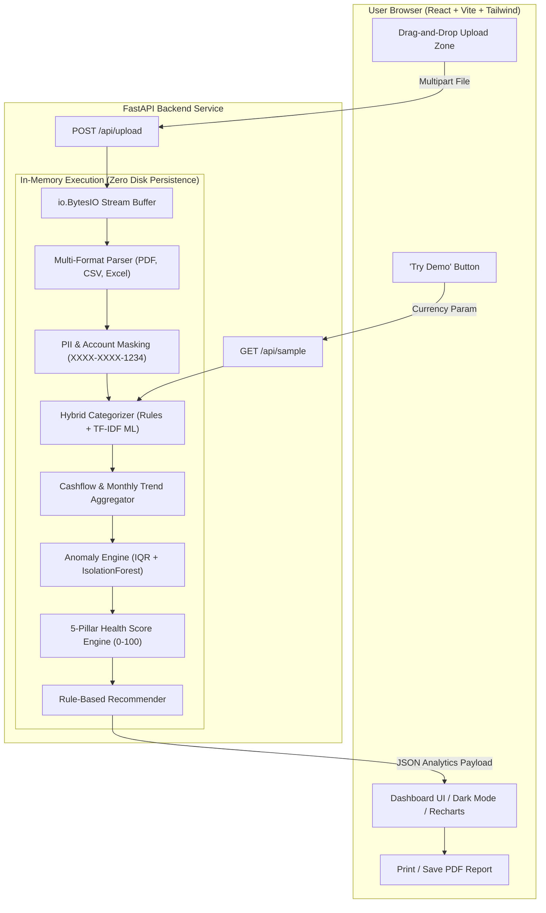

# FinHealth 💳
### Bank Statement Analysis & Financial Health Monitoring Engine

[](LICENSE)
[](https://fastapi.tiangolo.com/)
[](https://vitejs.dev/)
[](https://tailwindcss.com/)
[](https://www.python.org/)

FinHealth is a privacy-first, full-stack web application designed to help individuals demystify their finances. Upload any bank statement (**PDF, CSV, or Excel**) to automatically categorize transactions, detect recurring subscriptions and spending anomalies, compute a transparent **0–100 Financial Health Score**, and receive personalized financial recommendations.

---

## 📌 Problem Statement
Most people struggle to understand where their money actually goes. Raw bank statements are cluttered with cryptic merchant codes, inconsistent column layouts, and multi-page tables. Commercial personal finance apps often require invasive access to net banking credentials or store sensitive transaction histories in third-party databases.

**FinHealth solves this with a zero-storage, in-memory architecture**:
1. Upload your statement (PDF, CSV, or XLSX).
2. The server processes the bytes strictly in RAM (`io.BytesIO`) and immediately discards the file.
3. Account numbers and PII are redacted.
4. You get an interactive executive health dashboard with actionable financial insights.

---

## 🚀 Key Features

### 🔒 Privacy & Security Architecture
* **Strict In-Memory Processing**: Uploaded files never touch a hard disk, database, or cloud bucket.
* **Automatic PII Redaction**: Bank account numbers, card digits, phone numbers, and UPI handles are masked (`XXXX-XXXX-4589`).
* **Zero Persistence**: All memory is freed immediately upon HTTP response completion.

### 🧠 Backend Intelligence (FastAPI + Pandas + Scikit-Learn)
* **Universal Bank Statement Parser**: Ingests messy PDF statements via `pdfplumber`, multi-sheet Excel workbooks (`.xlsx`, `.xls`), and arbitrary CSV formats with dynamic header detection.
* **Hybrid Auto-Categorization**: 14 spending taxonomies (Food & Dining, Housing & Rent, EMI & Loans, Groceries, Utilities, Investments, Travel, Entertainment, etc.) matching keyword patterns with a TF-IDF Naive Bayes ML classifier fallback.
* **Statistical Anomaly Detection**: Flags unusual transactions using dynamic Interquartile Range (IQR) category deviation and Scikit-Learn's `IsolationForest`.
* **Recurring Subscriptions Engine**: Discovers repeating commitments (Netflix, Spotify, broadband, rent, loan EMIs, gym).
* **5-Pillar Health Score (0–100)**: Transparent deterministic scoring with a detailed factor breakdown.
* **Personalized Recommendations**: Rule-based optimization tips (e.g. "Dining spend rose 30% vs last month", emergency buffer adequacy, 50/30/20 budget alerts).
* **Demo Endpoint (`GET /api/sample`)**: Generates realistic 6-month statements for instant exploration without uploading real files.

### 💻 Frontend Experience (React + Vite + Tailwind + Recharts)
* **Landing Page**: Value proposition, format guides, and security guarantees.
* **Drag-and-Drop Uploader**: Real-time upload progress bar and instant demo loader.
* **Financial Health Score Gauge**: Animated radial arc with tier classifications (Excellent, Good, Fair, Needs Attention) and an interactive formula modal.
* **Cashflow Trend Chart**: Responsive Recharts area/bar chart tracking monthly inflows, outflows, and net savings.
* **Category Donut & Ranked List**: Interactive spend percentage breakdown with custom tooltips.
* **Recurring Subscriptions Panel**: Monthly commitments list with estimated burn rate.
* **Anomaly Alert Feed**: High/Medium/Low severity cards detailing unexpected outflows.
* **Searchable Transactions Ledger**: Filter by category, type (Debits/Credits/Anomalies), date, or merchant name, complete with CSV export and pagination.
* **Executive Printable Report**: Print or save to PDF with dedicated print stylesheet.
* **Dark / Light Mode**: Seamless theme switching with localStorage persistence.
* **Multi-Currency**: Toggle between Indian Rupees (**₹ INR**) and US Dollars (**$ USD**).

---

## 🏗️ Architecture Diagram



---

## 📐 Financial Health Score Model (0–100)

The overall score is a weighted composite of 5 personal finance pillars:

$$\text{Health Score} = S_{\text{savings}} + S_{\text{expense}} + S_{\text{debt}} + S_{\text{stability}} + S_{\text{consistency}}$$

| Pillar | Max Pts | Healthy Benchmark | Description |
| :--- | :---: | :--- | :--- |
| **1. Savings Rate** | **25 pts** | $\ge 20\%$ net savings | Rewards saving at least 20% of net monthly income. |
| **2. Expense-to-Income Ratio**| **25 pts** | $\le 50\%$ expenses | Penalizes living beyond one's means or overspending. |
| **3. Debt & EMI Burden** | **20 pts** | $\le 15\%$ DTI ratio | Assesses loan repayments, credit cards, and debt obligations relative to income. |
| **4. Balance Stability & Buffer**| **15 pts** | $\ge 2$ months runway | Evaluates cash cushion against monthly expenses and penalizes low-balance days. |
| **5. Spending Consistency** | **15 pts** | Low month-to-month variance | Rewards disciplined, predictable outflow habits versus erratic spending spikes. |

### Classification Tiers
* **80 – 100**: 🟢 **Excellent** (Strong financial resilience & savings discipline)
* **65 – 79**: 🔵 **Good** (Healthy fundamentals with minor optimization areas)
* **50 – 64**: 🟡 **Fair** (Vulnerable to financial shocks; high outflow ratio)
* **0 – 49**: 🔴 **Needs Attention** (Debt strain or recurring deficit spending)

---

## 📁 Project Structure

```
finhealth/
├── backend/
│   ├── app/
│   │   ├── config.py                 # Settings & CORS config
│   │   ├── main.py                   # FastAPI app & endpoints
│   │   ├── models/
│   │   │   └── schemas.py            # Pydantic v2 data models
│   │   ├── parsers/
│   │   │   ├── base.py               # Normalization & column inference
│   │   │   ├── csv_parser.py         # Multi-bank CSV parser
│   │   │   ├── excel_parser.py       # Excel (.xlsx/.xls) parser
│   │   │   └── pdf_parser.py         # pdfplumber table & regex parser
│   │   ├── services/
│   │   │   ├── analytics.py          # Cashflow & recurring subscriptions
│   │   │   ├── anomaly.py            # IsolationForest & IQR anomaly engine
│   │   │   ├── categorizer.py        # Rules + ML fallback classifier
│   │   │   ├── recommender.py        # Smart actionable advice engine
│   │   │   ├── sample_generator.py   # Realistic 6-month statement generator
│   │   │   └── scoring.py            # 5-Pillar Financial Health Score
│   │   └── utils/
│   │       └── privacy.py            # Account & PII masking
│   ├── tests/
│   │   ├── conftest.py               # Pytest path configuration
│   │   ├── test_api.py               # Integration tests
│   │   ├── test_categorizer.py       # Taxonomy tests
│   │   ├── test_parsers.py           # Parsing & masking tests
│   │   └── test_scoring.py           # Health score unit tests
│   ├── requirements.txt              # Python dependencies
│   └── .env.example
├── frontend/
│   ├── src/
│   │   ├── components/
│   │   │   ├── AnomalyAlerts.jsx     # Outlier alerts
│   │   │   ├── CashflowTrendChart.jsx# Monthly inflow vs outflow Recharts
│   │   │   ├── CategoryBreakdown.jsx # Donut & ranked spending list
│   │   │   ├── HealthScoreGauge.jsx  # Radial gauge & formula modal
│   │   │   ├── HeroUpload.jsx        # Drag-and-drop file uploader
│   │   │   ├── Navbar.jsx            # Header, theme, & currency toggle
│   │   │   ├── Recommendations.jsx   # Actionable financial advice
│   │   │   ├── RecurringPayments.jsx # Detected subscriptions
│   │   │   ├── ReportModal.jsx       # Printable executive report
│   │   │   ├── SummaryCards.jsx      # KPI summary cards
│   │   │   └── TransactionsTable.jsx # Searchable & filterable ledger
│   │   ├── context/
│   │   │   └── ThemeContext.jsx      # Dark/light theme provider
│   │   ├── services/
│   │   │   └── api.js                # API client with XHR progress
│   │   ├── App.jsx                   # Root application state
│   │   ├── index.css                 # Tailwind & print styles
│   │   └── main.jsx
│   ├── index.html
│   ├── package.json
│   ├── tailwind.config.js
│   ├── vite.config.js
│   └── .env.example
├── sample_data/
│   ├── sample_bank_statement.csv     # Ready-to-upload sample statement
│   └── sample_bank_statement.xlsx    # Excel format test statement
├── DEPLOYMENT.md                     # Step-by-step deployment guide
├── LICENSE                           # MIT License
└── README.md
```

---

## 🛠️ Local Development Setup

### Prerequisites
* **Python 3.10+**
* **Node.js 18+** and **npm**

### 1. Backend Setup
```bash
cd backend

# Create virtual environment
python -m venv venv

# Activate virtual environment
# Windows:
.\venv\Scripts\activate
# macOS/Linux:
# source venv/bin/activate

# Install dependencies
pip install -r requirements.txt

# Run test suite
pytest -v

# Start FastAPI development server
uvicorn app.main:app --reload --port 8000
```
Backend will be live at `http://127.0.0.1:8000`. You can explore the interactive OpenAPI documentation at `http://127.0.0.1:8000/docs`.

### 2. Frontend Setup
In a new terminal:
```bash
cd frontend

# Install packages
npm install

# Start Vite dev server with proxy
npm run dev
```
Open `http://localhost:5173` in your browser.

---

## 🧪 Testing Guide

FinHealth includes a comprehensive test suite validating parsers, categorizer accuracy, PII masking, and 5-pillar scoring algorithms:

```bash
cd backend
pytest -v
```

All 12 test suites cover:
- CSV parser edge cases and currency detection
- Column identification across Indian and international banks
- PII masking for account numbers, card digits, and UPI VPAs
- 5-pillar health score boundaries (Zero income, Deficit, and Optimal)
- Keyword categorizer and ML fallback pipeline
- FastAPI endpoints (`/api/health`, `/api/sample`, `/api/upload`)

---

## 🌐 Public Deployment (Render + Vercel)

For a complete step-by-step guide with screenshots and environment settings, see [DEPLOYMENT.md](DEPLOYMENT.md).

* **Backend on Render**:
  - Root directory: `backend`
  - Build command: `pip install -r requirements.txt`
  - Start command: `uvicorn app.main:app --host 0.0.0.0 --port $PORT`
* **Frontend on Vercel**:
  - Root directory: `frontend`
  - Framework: `Vite`
  - Environment variable: `VITE_API_URL=https://<your-render-backend>.onrender.com`

---

## ⚖️ License
Distributed under the [MIT License](LICENSE).
Free for personal, commercial, and educational use.
